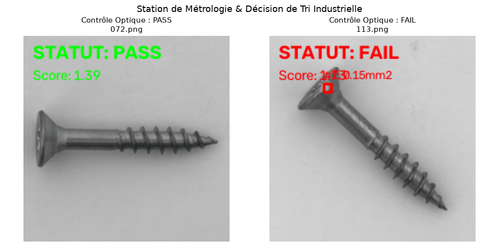
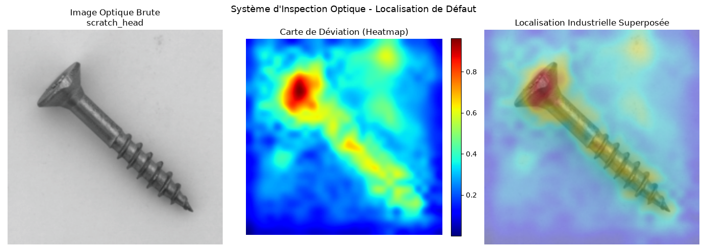

# Edge-Vision Defect Inspection Pipeline


An end-to-end industrial optical inspection and metrology system implemented in Python, PyTorch, OpenCV, and ONNX Runtime, evaluated on the **MVTec AD** (`screw`) benchmark.


The pipeline performs unsupervised surface anomaly localization using multi-scale deep feature extraction (ResNet-18) combined with spatial neighborhood aggregation and nearest-neighbor retrieval. Detected anomalies are segmented and measured in physical units (mm²) via an optical post-processing module for automated **PASS/FAIL** quality control.


---


## Visual Results & Industrial Inspection


### 1. Optical Metrology & Quality Gating (Pass / Fail)

Automated defect detection comparing a nominal screw (PASS) against an anomalous unit with a damaged thread/head (FAIL):





### 2. Multi-Scale Feature Anomaly Localization

Continuous anomaly heatmap generated via intermediate feature space deviation (layer2 + layer3) with local neighborhood pooling:





---


## Key Performance Results

| Metric | PyTorch Baseline | Feature Aggregation (Optimized) | Target / Requirement |
| :--- | :---: | :---: | :---: |
| **AUROC (Overall)** | 82.74 % | **90.84 %** | > 90.0 % |
| **Precision** | 94.83 % | **96.00 %** | Low False Alarm Rate |
| **Defect Sensitivity (Recall)** | 46.22 % | **60.50 %** | High Defect Capture |
| **F1-Score** | 62.15 % | **74.23 %** | Balanced Performance |

### Inference Latency Benchmark (Intel/AMD CPU)

Inference speed evaluated over 100 iterations with normalized 224x224x3 frames:

| Runtime Engine | Latency / Frame | Throughput | Latency Reduction |
| :--- | :---: | :---: | :---: |
| **PyTorch Native (CPU)** | 12.32 ms | 81.1 FPS | Baseline |
| **ONNX Runtime (CPU)** | **4.56 ms** | **219.3 FPS** | **-63.0 %** |


---


## System Architecture


```text

Input Frame (224x224x3)

         │

         ▼

[Frozen ResNet-18 Backbone] ────► Multi-scale feature maps (layer2: 28x28, layer3: 14x14)

         │

         ▼

[Local Neighborhood Pooling] ───► 3x3 AvgPool2d spatial smoothing (reduces optical noise)

         │

         ▼

[Memory Bank Indexing] ─────────► Nearest-Neighbor distance query (k-NN, Euclidean)

         │

         ▼

[Raw Anomaly Heatmap] ──────────► Absolute metric thresholding (> 1.70 distance)

         │

         ▼

[OpenCV Post-Processing] ───────► Connected Components Analysis (cv2.connectedComponentsWithStats)

         │

         ▼

[Metrology & Decision HUD] ─────► Defect bounding box, real area (mm²), PASS/FAIL classification

```


---


## Repository Structure


```text

defect-vision-screw/

├── assets/                   # Visual inspection results and screenshots

│   ├── heatmap_localization.png

│   └── metrology_inspection.png

├── data/

│   └── screw/                # MVTec AD dataset partition (train/good, test splits)

├── models/

│   └── backbone.onnx         # Optimized static ONNX computational graph

├── src/

│   ├── __init__.py

│   ├── data_loader.py        # PyTorch Dataset and DataLoader with ImageNet transforms

│   ├── feature_extractor.py  # Frozen ResNet-18 intermediate extractor with AvgPool2d

│   ├── anomaly_detector.py   # Multi-scale patch alignment and k-NN memory bank

│   └── inspector.py          # Metrology module, OpenCV bounding boxes, and Pass/Fail gating

├── setup_data.py             # Automated dataset ingestion from public mirrors

├── explore_data.py           # Optical frame inspection visualizer

├── evaluate.py               # Benchmark script (AUROC, Precision, Recall, Confusion Matrix)

├── visualize_heatmap.py      # Spatial anomaly heatmap visualizer (Jet overlay)

├── run_inspection.py         # Full quality control execution with metric HUD

├── export_onnx.py            # Static ONNX graph export (Opset 18)

└── benchmark_latency.py      # Profiling script comparing PyTorch CPU vs ONNX Runtime

```


---


## Getting Started


### 1. Environment Setup


```powershell

git clone https://github.com/victor-saunier/defect-vision-screw.git

cd defect-vision-screw

python -m venv venv

.\venv\Scripts\Activate.ps1

pip install torch torchvision opencv-python matplotlib scikit-learn datasets onnx onnxruntime onnxscript

```


### 2. Dataset Ingestion


```powershell

python setup_data.py

```


### 3. Pipeline Evaluation


```powershell

python evaluate.py

```


### 4. Industrial Metrology & Inspection


```powershell

python run_inspection.py

```


### 5. ONNX Export & Latency Benchmark


```powershell

python export_onnx.py

python benchmark_latency.py

```


---


## Engineering Highlights


* **Unsupervised Anomaly Modeling:** Solves manufacturing class imbalance by constructing a nominal geometric memory bank exclusively from 320 non-defective parts (`train/good`).

* **Noise Rejection via Spatial Pooling:** Mitigates high-frequency surface noise and specular reflection by applying local neighborhood pooling (`AvgPool2d`, kernel=3) on intermediate feature representations.

* **Calibrated Physical Metrology:** Converts segmented pixel clusters into physical surface measurements (mm²) using an optical calibration factor (50 µm / pixel), eliminating edge artifacts via calibrated absolute Euclidean distance thresholding.

* **Edge-Optimized Runtime:** Eliminates autograd overhead and leverages AVX/SIMD vectorization via ONNX Runtime, achieving a throughput of **> 200 FPS** on commodity CPU hardware.
