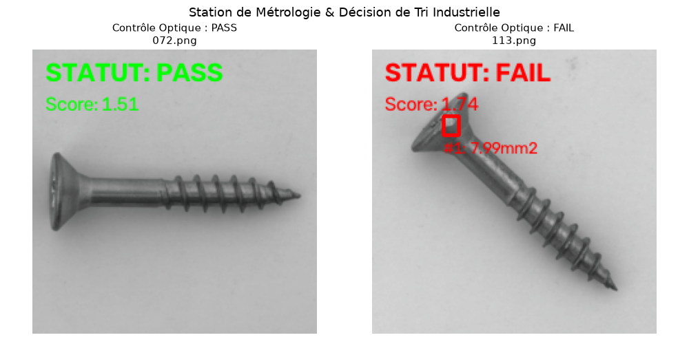
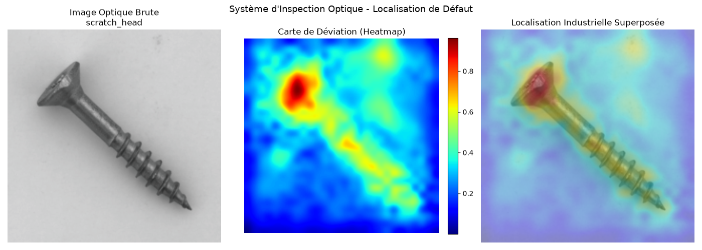
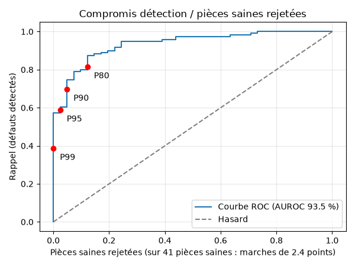

# Edge-Vision Defect Inspection Pipeline


An end-to-end industrial optical inspection and metrology system implemented in Python, PyTorch, OpenCV, and ONNX Runtime, evaluated on the **MVTec AD** (`screw`) benchmark.


The pipeline performs unsupervised surface anomaly localization using multi-scale deep feature extraction (ResNet-18) combined with spatial neighborhood aggregation and nearest-neighbor retrieval. Detected anomalies are segmented and measured in physical units (mm²) via an optical post-processing module for automated **PASS/FAIL** quality control.


---


## Visual Results & Industrial Inspection


### 1. Optical Metrology & Quality Gating (Pass / Fail)

Automated defect detection comparing a nominal screw (PASS) against an anomalous unit with a damaged thread/head (FAIL):





### 2. Multi-Scale Feature Anomaly Localization

Continuous anomaly heatmap generated via intermediate feature space deviation (layer2 + layer3) with local neighborhood pooling:





---


## Key Performance Results

| Metric | Baseline (no pooling, 10 % memory bank) | Feature Aggregation (Optimized) | Target / Requirement |
| :--- | :---: | :---: | :---: |
| **AUROC (Overall)** | 84.32 ± 1.04 % | **93.06 ± 0.99 %** | > 90.0 % |
| **Precision** | 97.82 ± 2.32 % | **98.66 ± 0.92 %** | Low False Alarm Rate |
| **Defect Sensitivity (Recall)** | 41.18 ± 7.68 % | **60.84 ± 1.93 %** | High Defect Capture |
| **F1-Score** | 57.55 ± 8.06 % | **75.25 ± 1.30 %** | Balanced Performance |

Values are the mean ± standard deviation over 5 random seeds (0 to 4), which change the 5-fold split and the random draw of the memory-bank patches.

Both columns use the same protocol (decision threshold = 95th percentile of 5-fold cross-validated nominal scores, never tuned on the test set) and the same 160 test images (41 nominal, 119 defective). The only differences are the 3x3 neighborhood pooling and the memory bank size (10 % vs 20 % of the patches). The AUROC gain (about 9 points) is roughly nine times the seed-to-seed standard deviation, whereas the precision difference is within that spread and should not be read as an improvement. The baseline recall is unstable (27.7 % to 46.2 % depending on the seed). Reproduce with `python evaluate.py --seeds 5` and `python evaluate.py --baseline --seeds 5` (about 7 and 3 minutes). The operating-point table and the ROC curve below come from seed 0 only.

### Choosing the Operating Point (Detection vs. False Alarms)

The decision threshold is a business choice: a lower threshold catches more defects but rejects more good parts. Each threshold below is the given percentile of the cross-validated scores of **nominal parts only**; the test set is used to report the effect of each setting, not to pick it.

| Threshold (percentile of nominal scores) | Recall | Good parts rejected | Precision (test set) |
| :--- | :---: | :---: | :---: |
| P99 | 38.7 % | 0.0 % | 100.0 % |
| **P95 (default)** | 58.8 % | 2.4 % | 98.6 % |
| P90 | 69.7 % | 4.9 % | 97.6 % |
| P80 | 81.5 % | 12.2 % | 95.1 % |



* The ROC curve plots recall against the share of good parts rejected; the area under it is the AUROC (93.5 % for seed 0). The red points are the four thresholds above.
* Only 41 nominal test images exist, so each rate is coarse (one image = 2.4 points) and the curve is stepped.
* The test set contains 74 % defective parts, which inflates the precision column (see Limitations).
* The threshold used by `run_inspection.py` can be changed with `python evaluate.py --percentile 90`.

### Inference Latency Benchmark (Intel Core i9-13900HX, CPU)

Feature-extraction backbone only (ResNet-18 up to layer3), 224x224x3 frames. Median latency over 200 iterations, ranges observed over 4 runs (the laptop CPU frequency varies between runs, the relative gain stays stable):

| Runtime Engine | Latency / Frame | Throughput | Latency Reduction |
| :--- | :---: | :---: | :---: |
| **PyTorch Native (CPU)** | 9.3 – 15.3 ms | 65 – 108 FPS | Baseline |
| **ONNX Runtime (CPU)** | **3.5 – 5.1 ms** | **196 – 284 FPS** | **-62 to -70 %** |

These figures cover the backbone only. The complete inspection also runs the k-NN search of every patch against the memory bank, which is not exported to ONNX. Timed once on the same CPU with an ad hoc script (median of 10 runs, not included in the repository): backbone ≈ 12 ms, k-NN search ≈ 154 ms, full `inspect()` ≈ 205 ms, i.e. about **5 images/s** end to end. The ONNX speed-up therefore applies to roughly 6 % of the total time, and the k-NN search is the real bottleneck.


---


## System Architecture


```text

Input Frame (224x224x3)

         │

         ▼

[Frozen ResNet-18 Backbone] ────► Multi-scale feature maps (layer2: 28x28, layer3: 14x14)

         │

         ▼

[Local Neighborhood Pooling] ───► 3x3 AvgPool2d spatial smoothing (reduces optical noise)

         │

         ▼

[Memory Bank Indexing] ─────────► Nearest-Neighbor distance query (k-NN, Euclidean)

         │

         ▼

[Raw Anomaly Heatmap] ──────────► Absolute metric thresholding (calibrated on held-out nominal parts)

         │

         ▼

[OpenCV Post-Processing] ───────► Connected Components Analysis (cv2.connectedComponentsWithStats)

         │

         ▼

[Metrology & Decision HUD] ─────► Defect bounding box, real area (mm²), PASS/FAIL classification

```


---


## Repository Structure


```text

defect-vision-screw/

├── .github/workflows/ci.yml  # CI: runs the unit tests on every push and pull request

├── assets/                   # Visual inspection results and screenshots

│   ├── heatmap_localization.png

│   ├── metrology_inspection.png

│   └── roc_curve.png

├── data/

│   └── screw/                # MVTec AD dataset partition (train/good, test splits)

├── models/

│   ├── backbone.onnx         # Optimized static ONNX computational graph (backbone only)

│   └── threshold.json        # Decision threshold written by evaluate.py (not versioned)

├── src/

│   ├── data_loader.py        # PyTorch Dataset and DataLoader with ImageNet transforms

│   ├── feature_extractor.py  # Frozen ResNet-18 intermediate extractor with AvgPool2d

│   ├── anomaly_detector.py   # Multi-scale patch alignment and k-NN memory bank

│   └── inspector.py          # Metrology module, OpenCV bounding boxes, and Pass/Fail gating

├── tests/                    # Unit tests (pytest) on synthetic data, no dataset needed

│   ├── test_data_loader.py   # Label parsing and 5-fold split (disjoint, full coverage)

│   ├── test_detector.py      # Feature fusion shapes (128 + 256 -> 384 channels)

│   └── test_inspector.py     # PASS/FAIL decision and pixel -> mm² conversion

├── setup_data.py             # Automated dataset ingestion from public mirrors

├── explore_data.py           # Optical frame inspection visualizer

├── evaluate.py               # Benchmark script (AUROC, Precision, Recall, operating points, ROC curve)

├── visualize_heatmap.py      # Spatial anomaly heatmap visualizer (Jet overlay)

├── run_inspection.py         # Full quality control execution with metric HUD

├── export_onnx.py            # Static ONNX graph export (Opset 18)

├── benchmark_latency.py      # Profiling script comparing PyTorch CPU vs ONNX Runtime

├── requirements.txt          # Pinned runtime dependencies

├── requirements-dev.txt      # Runtime dependencies + pytest

└── pytest.ini                # pytest configuration

```


---


## Getting Started


### 1. Environment Setup

Tested with Python 3.13. To also run the unit tests, install `requirements-dev.txt` instead and run `pytest`.


```powershell

git clone https://github.com/victor-saunier/defect-vision-screw.git

cd defect-vision-screw

python -m venv venv

.\venv\Scripts\Activate.ps1

pip install -r requirements.txt

```


### 2. Dataset Ingestion


```powershell

python setup_data.py

```


### 3. Pipeline Evaluation


```powershell

python evaluate.py

python evaluate.py --baseline   # optional: initial version, for comparison

python evaluate.py --seeds 5   # optional: mean and standard deviation over 5 random seeds (about 7 minutes)

python evaluate.py --percentile 90   # optional: lower threshold, more defects caught, more false alarms

```


### 4. Industrial Metrology & Inspection

Requires step 3 first: `evaluate.py` calibrates the decision threshold and saves it to `models/threshold.json`.


```powershell

python run_inspection.py

```


### 5. ONNX Export & Latency Benchmark


```powershell

python export_onnx.py

python benchmark_latency.py

```


---


## Engineering Highlights


* **Unsupervised Anomaly Modeling:** Solves manufacturing class imbalance by constructing a nominal geometric memory bank exclusively from 320 non-defective parts (`train/good`).

* **Noise Rejection via Spatial Pooling:** Mitigates high-frequency surface noise and specular reflection by applying local neighborhood pooling (`AvgPool2d`, kernel=3) on intermediate feature representations.

* **Calibrated Physical Metrology:** Converts segmented pixel clusters into physical surface measurements (mm²) using an optical calibration factor (50 µm / pixel), with the threshold calibrated (95th percentile) with 5-fold cross-validation on the 320 nominal training parts, never on the test set, and areas rescaled to the native 1024 px resolution.

* **Edge-Optimized Runtime:** Eliminates autograd overhead and leverages AVX/SIMD vectorization via ONNX Runtime, achieving a backbone throughput of roughly **200 – 280 FPS** on a laptop CPU. The complete pipeline, which also includes the k-NN search, runs at about 5 images/s on the same CPU (see the latency section).

---

## Limitations

This is a prototype evaluated on a public benchmark, not a validated production system. The points below explain what the results do and do not show.

**1. Small test set: the rates are rough orders of magnitude.**
* The test set has 160 images (119 defective, only 41 nominal) and the confidence intervals below are computed on the seed-0 results.
* The 5 random seeds quantify the randomness of the algorithm (about 1 point of AUROC for both versions). They do not capture the uncertainty due to the small test set, which is the subject of this point.
* Example: 1 good part rejected out of 41 is a 2.4 % false-alarm rate, but the 95 % confidence interval is 0.06 % to 12.9 %. The recall of 58.8 % (70 / 119) has an interval of 49.4 % to 67.8 %.
* These are exact binomial (Clopper-Pearson) intervals: the range of true rates for which the observed result would not be rarer than 2.5 % on either side. They are not computed by the project code; to reproduce them: `scipy.stats.binomtest(1, 41).proportion_ci(method="exact")`.
* With 41 nominal images, rates move in steps of 2.4 points: the P95 and P90 rows (2.4 % vs 4.9 %) differ by a single image.
* To reduce this: more nominal test images.

**2. Real production has far fewer defects than the test set.**
* The test set is 74 % defective, which inflates precision. In production defects are rare: a fastener supplier quotes about 200 PPM (0.02 %) as an accepted level in high-volume production (vendor figure, indicative only).
* Illustration for 100,000 parts, assuming 200 PPM and the measured 2.4 % false-alarm rate: about 20 defective parts, of which about 12 are detected, and about 2,400 good parts flagged.
* Used as **automatic rejection**, the system would scrap about 2,400 good parts to remove 12 defective ones. Used as an **inspection aid** (it flags parts and a human decides), an operator checks about 2,400 parts and finds about 12 defects, whereas checking as many parts at random would find about 0.5 on average. The intended use is the second one.

**3. The pixel size is assumed and the measured areas are not validated.**
* Converting pixels to mm² requires the real size of one pixel, which depends on the camera, the lens and the distance. The 50 µm / pixel used here is an assumption: if the real value were 100 µm, every area would be 4 times larger. A real deployment would measure it with a reference target of known dimensions.
* MVTec provides ground-truth masks (images marking the defective pixels), which this project does not use. The system is evaluated on whether it flags a part, not on whether the area it outlines matches the real defect. Validating areas would require comparing the detected regions with those masks.

**4. The ONNX speed-up covers only a small part of the pipeline.**
* The ONNX export and the latency table cover the ResNet-18 backbone only. The k-NN search takes about 154 ms against about 12 ms for the backbone (single ad hoc measurement), so the complete pipeline runs at about 5 images/s on the test laptop.
* Speeding up the search (for example with an approximate nearest-neighbor library) would be the first lever to try.
